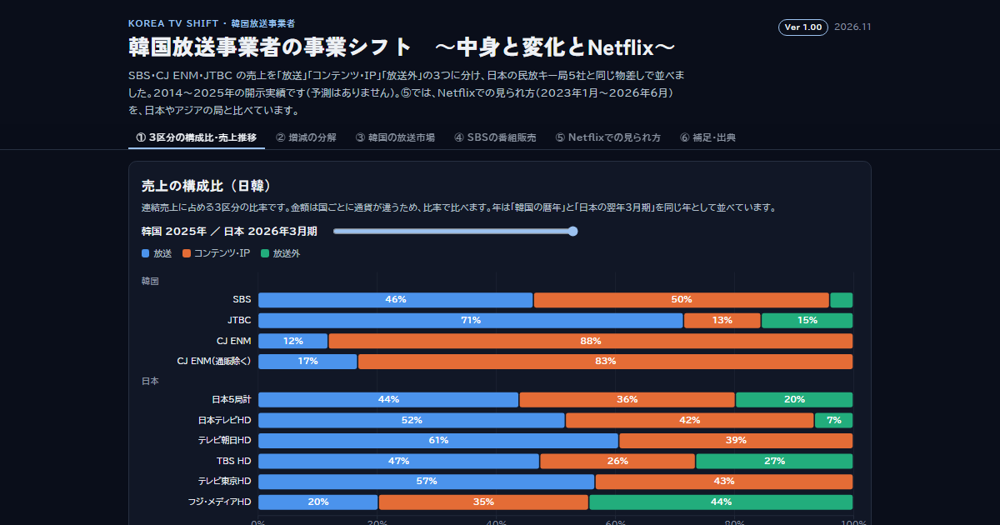

# 韓国放送事業者の事業シフト 2014→2025（KOREA TV SHIFT）

韓国放送事業者（SBS・CJ ENM・JTBC）の売上を「放送」「コンテンツ・IP」「放送外」の3つに分け、日本の民放キー局5社と同じ物差しで比べるダッシュボードです。2014〜2025年の開示実績と、Netflixでの見られ方（2023年1月〜2026年6月）を、日本やアジアの局と並べます。予測はありません。

👉 **[ダッシュボードを開く（GitHub Pages）](https://naohisastry.github.io/korea-broadcast-shift-2025/)**

## 画面の構成

| タブ | 直リンクURL | 内容 |
|---|---|---|
| ① 3区分の構成比・売上推移 | [`#composition`](https://naohisastry.github.io/korea-broadcast-shift-2025/#composition) | 日韓の局の売上の3区分の比率と、会社別の推移 |
| ② 増減の分解 | [`#breakdown`](https://naohisastry.github.io/korea-broadcast-shift-2025/#breakdown) | 基準年からの増減を3区分に分解 |
| ③ 韓国の放送市場 | [`#market`](https://naohisastry.github.io/korea-broadcast-shift-2025/#market) | 事業者の区分別の売上、地上波の売上の中身、テレビ画面でのOTT利用推移、番組制作費比率 |
| ④ SBSの番組販売 | [`#sbs`](https://naohisastry.github.io/korea-broadcast-shift-2025/#sbs) | 本体とグループの番組販売、Studio S、Wavve |
| ⑤ Netflixでの見られ方 | [`#netflix`](https://naohisastry.github.io/korea-broadcast-shift-2025/#netflix) | 世界の視聴時間に占める比率、国別トップ10、局ごとの世界配信の比率と海外のトップ10、日本のアニメの系列別の集計 |
| ⑥ 補足・出典 | [`#sources`](https://naohisastry.github.io/korea-broadcast-shift-2025/#sources) | 区分の定義、組み立て方、出典、注意、ライセンス |

## 関連

- note 連載「視聴者接点の再編・韓国編」『Netflixと組んだ韓国の放送局は、何を得て何を失ったか』（全3回）：https://note.com/naohisas
- TV-Shift 2035（日本の民放キー局5社）：https://naohisastry.github.io/japan-commercial-tv-shift-2035/v2/

## 出典

- DART（韓国 金融監督院 電子公示システム）の事業報告書・監査報告書
- 방송미디어통신위원회「방송사업자 재산상황 공표집」2015〜2025年版
- Netflix「What We Watched」、Netflix Top 10
- 詳細は [DATA_SOURCES.md](DATA_SOURCES.md) とダッシュボードの「⑥補足・出典」

## ローカルで開く

`index.html` をブラウザで開くだけで動きます（グラフの描画に d3 を CDN から読み込むため、ネット接続が必要です）。

## 🔑 Keywords

korea-broadcasting, tv-shift, netflix-analytics, data-visualization, d3js, media-architecture, broadcast-revenue, sbs, cj-enm, jtbc

## License / ライセンス

- **Code**（HTML / CSS / JavaScript）: [MIT License](LICENSE)
- **Content**（文章・図表・分析結果・整理済みデータ）: [CC BY 4.0](LICENSE-CONTENT.md)
- 出典表示例 / Attribution: Naohisa Hashimoto, "韓国放送事業者の事業シフト 2014→2025（KOREA TV SHIFT）", https://naohisastry.github.io/korea-broadcast-shift-2025/
- 第三者の元データの権利は各発行元に帰属します。

© 2026 Naohisa Hashimoto
